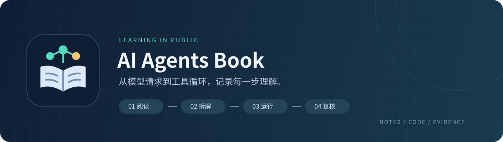

<p align="center">
  
</p>

<h1 align="center">📚 AI Agents Book学习记录</h1>

<p align="center">从一次模型请求开始，逐步理解Agent的工具调用、消息流与执行循环。</p>

[](https://github.com/lizhuofan-curry/ai-agents-book-learning/actions/workflows/ci.yml)
[](pyproject.toml)
[](uv.lock)
[](LICENSE)

<p align="center">
  <a href="第一章/README.md">🧭 章节导航</a> ·
  <a href="第二章/README.md">🧠 上下文工程</a> ·
  <a href="第三章/README.md">💾 用户记忆</a> ·
  <a href="第一章/1.2网络搜索Agent/README.md">🔎 搜索Agent</a> ·
  <a href="第一章/1.2网络搜索Agent/实验记录.md">📝 运行记录</a> ·
  <a href="https://github.com/bojieli/ai-agent-book">📖 原教材</a>
</p>

## 🌱 为什么整理这个仓库

学习[李博杰的《深入理解AI Agent》](https://github.com/bojieli/ai-agent-book)时，我觉得原仓库的代码和目录比较分散，章节、实验与代码之间的对应关系不太直观，查找和复习时不太方便。

因此，我一边阅读和理解原代码，一边按章节和实验整理项目结构，补充适合自己学习节奏的代码、注释和运行记录。这里记录的是我实际学习和动手的过程。

| 在这里看什么 | 内容 |
|---|---|
| 🧩 分步代码 | 从离线观察到真实搜索，把完整Agent拆成01～10个学习步骤 |
| 💬 阅读指南 | 解释输入、处理、输出，以及变量和消息如何变化 |
| 🧪 运行证据 | 保存JSON、调用轨迹、正常回答和达到轮数上限的记录 |
| 🔍 来源核查 | 对照来源检查答案，记录日期错误、引用问题与未确认的描述 |

## 🗂️ 项目结构

```text
AI_Agents_Book/
├── assets/                 # 自制书本与Agent节点图标、README横幅
├── 第一章/
│   ├── 1.1上下文消融/
│   ├── 1.2网络搜索Agent/
│   │   ├── 我的代码/       # 按学习步骤编号的代码
│   │   ├── 运行结果/       # 离线演示与实际运行记录
│   │   └── README.md       # 当前进度、代码说明与官方链接
│   ├── 1.3搜索与代码执行/
│   ├── 1.4图像生成工作流/
│   └── 拓展-从经验中学习/
├── 第二章/                 # 上下文工程、状态栏与压缩策略实验
├── 第三章/                 # 用户记忆与知识库，3-1本地固定配置评估已收尾
├── ai-agent-book/           # 已有的教材总览、排期与实验清单
├── .env.example            # API配置模板
├── pyproject.toml           # uv依赖配置
└── uv.lock                  # 依赖版本锁定
```

## ✅ 第一章学习进度

第一章已按本人的学习范围完成（2026-10-06）。本章重点学习了Agent循环、工具调用、上下文消融和图像生成工作流；实验1.3由本人决定跳过，目录仅保留为官方内容索引。

- **实验1.1已完成**：运行DeepSeek兼容的四组上下文消融。完整上下文组正确完成任务，其余组展示了历史、工具定义和工具结果的作用；`no_reasoning`受DeepSeek工具协议限制，未作为等价实验运行。
- **实验1.2已完成**：真实运行模型对话、搜索工具、结果回传、完整Agent循环、交互提问、命令行参数与引导式体验。详见[实验记录](第一章/1.2网络搜索Agent/实验记录.md)。
- **实验1.3已跳过**：根据个人学习安排不再实施搜索与代码执行实验，保留[官方实验索引](第一章/1.3搜索与代码执行/README.md)。
- **实验1.4本地核心版已完成**：使用同一个万相模型比较原始提示词与DeepSeek改写提示词，2个需求、2条路线共4张图全部成功，并完成逐项评分。官方5需求×3路线未全量复现。详见[实验报告](第一章/1.4图像生成工作流/运行结果/20261006_105801/实验报告.md)。

以下表格保留实验1.2的分步运行摘要：

| 学习步骤 | 已观察到的结果 |
|---|---|
| 01·离线观察 | 已运行预写轨迹，理解行动、观察与回答的关系 |
| 02～06·真实搜索循环 | Context Caching问题完成4轮模型请求、9次成功搜索；调用ID与结果回传已核对 |
| 07·统一入口 | Python3.12问题完成2轮模型请求、1次搜索；主要答案已核对官方资料 |
| 08·交互提问 | 两个独立问题均完成；天气答案的更新时间与部分描述尚未确认 |
| 09·命令行参数 | 已观察轮数上限、失败保存、正常回答、quiet与指定输出路径 |
| 10·引导式体验 | 已真实运行菜单退出及现成问题搜索：2轮模型请求、2次搜索；回答中的当前日期有误 |

工具返回成功、循环正常结束和答案事实正确，需要分别检查。离线演示使用预写轨迹；真实问答的原始回答保存在JSON中，核查说明写在实验记录中，不覆盖模型原文。

## 📖 第二章学习进度

更新日期：2026-10-15。第二章正文已读完，已完成本地模型与工具调用、注意力可视化、KV缓存、提示工程消融、提示注入及状态栏等学习测量；实验2.7暂缓。助手生成代码与讲解，用户运行模型并反馈，结果按实际输出记录。

| 近期内容 | 当前结果与范围 |
|---|---|
| 2.6论文生成演示文稿 | 已从原始论文生成14页PPTX并完成渲染与视觉检查 |
| 2.8状态栏与注意力 | 两组各3次生成均拒绝再次拨号；未观察到行为正确率提升 |
| 2.9状态栏技术对照 | 原Qwen15任务均未通过；DeepSeek基础工具链3项通过，新15任务对照已结束：关闭/单项/全部提醒分别5/5、5/5、4/5，共55次请求 |
| 2.10上下文压缩策略对比 | 完成本机固定材料与真实三网页六策略对照；后者六组事实均6/6，含摘要的总用量未降低 |

这些是本轮学习范围内的测量，包含本地模型和DeepSeek云端补充实验，具体协议、原始输出和限制见[第二章导航](第二章/README.md)、[2.9排查记录](第二章/2.9状态栏技术对照/结果分析.md)与[2.10真实多网页说明](第二章/2.10上下文压缩策略对比/真实多网页六策略说明.md)。基础工具链通过不等于状态栏有效，也不将小规模学习结果写成官方全量复现。

## 📖 第三章学习进度

实验3-2的[50组学习范围已收尾](第三章/3.2记忆格式对照/05_50组学习结果总结.md)，原190组不再开展。3-3的[两条合成日志小结](第三章/3.3日志脱敏/03_两条样例学习总结.md)已完成：密码改写后规则2/4→3/4，4B两条均4/4，指定调试信息保留；不称通用PII召回率或安全部署验收。当前[3-4稠密向量检索](第三章/3.4稠密向量检索/README.md)的二维向量基础已由用户实测并核对，Top-3为A/B/C，模型和网络请求均0。合成向量ANNOY/HNSW入口、依赖锁及离线检查已准备；C++/SDK与三个索引依赖已安装，导入及6向量原生健康检查通过。3000向量、100查询正式对照已实测核对：ANNOY召回16.9%，HNSW ef=20/200为55.7%/99.2%，高召回HNSW本次耗时与精确排序接近。见[索引对照总结](第三章/3.4稠密向量检索/03_合成向量索引对照总结.md)；MiniLM真实文本也已实测核对：官方12篇文档、5条查询，Recall@5=1、Precision@5=0.32、MRR=1，两索引Top-5均与精确结果一致。本地CLI学习范围已收尾，见[实验3-4小结](第三章/3.4稠密向量检索/04_真实文本结果与实验3-4小结.md)，未扩展BGE-M3 HTTP服务。当前[3-5 BM25稀疏检索](第三章/3.5BM25稀疏检索/README.md)本地CLI学习范围已实测核对并总结：同一12篇文档/5查询下，BM25共同口径Recall/Precision/MRR@5为0.6/0.16/0.6，已保存MiniLM为1/0.32/1；逐词贡献和编码展示已核对，模型和网络请求均0。见[3-5小结](第三章/3.5BM25稀疏检索/02_结果分析与学习小结.md)；[3-6混合检索](第三章/3.6混合检索/README.md)第一步融合已由用户实测并独立核对：RRF与加权融合Recall/Precision/MRR@5均1/0.32/0.9，原稠密为1/0.32/1；一题首个相关结果排名下降。2026-10-18已完成轻量神经重排27对、5批CPU评分，无截断；保存输入、分数、排名及指标已独立核对，重排仍为1/0.32/0.9。3-6本地同语料学习范围已收尾，见[最终小结](第三章/3.6混合检索/05_重排结果与实验3-6小结.md)；未部署默认BGE或HTTP服务。[3-7结构化索引](第三章/3.7结构化索引/README.md)第一步人工示意对照已由用户运行3条查询，60项独立核对通过并形成小结；扁平已召回前两题所需事实，图补充路径与关系对齐，第三题为预写摘要。第一步无模型请求；第二步两段Intel原文已完成3次本机4B请求及53项机械核对，原图13节点/2条边，摘要3条。语义检查发现关系类型和摘要范围问题，原始草稿保留；第三步助手修订视图的固定查询已由用户运行并通过52项核对，14节点/14边、无孤立节点；返回MOVAPS两跳和CPUID探测一跳路径，4条摘要来源一致。属于助手编辑干预，非模型自动提升，也不代表用户已逐条语义验收。后续社区/聚类及递归层次摘要未进行，3-7仍部分完成。

2026-10-17实验3-1本地固定配置评估已收尾：使用qwen3:4b、notes、schema及推荐采样处理官方60题，6份完整回答均完成DeepSeek独立评分，4题通过、2题未通过，54题截断单列。全用例流程通过率6.67%，仅已评分通过率66.67%、平均reward=0.5833；没有60份完整裁判评分，不将截断补为裁判0分。见[结果总结](第三章/3.1用户记忆评估/08_实验3-1结果总结.md)及[第三章导航](第三章/README.md)。后续进度见上方章节状态；沿用助手生成代码与讲解、用户亲自运行并反馈的分工。

本周周报草稿保存在本地工作区外，根据实际运行逐项补充。

## 🙏 来源与改动

学习代码参考[原仓库的实验1.2实现](https://github.com/bojieli/ai-agent-book/tree/main/chapter1/web-search-agent)，按当前理解拆成较小步骤，补充中文注释，并调整为本项目的配置和输出路径。来源与许可见[THIRD_PARTY_NOTICES.md](THIRD_PARTY_NOTICES.md)。

## 🐍 本地环境与 macOS 运行

当前项目已从 Windows 迁移至 Mac，使用根目录 Python 3.12 环境。详细操作见 [macOS使用说明](docs/macOS使用说明.md)。

```bash
cd '/Users/zhuo/Agent相关/AI_Agents_Book'
# 首次建立或重建Mac环境：按锁文件安装，并处理ANNOY编译参数
bash scripts/setup_macos.sh

# 日常直接使用项目解释器；不需要每次重新安装
.venv/bin/python '第一章/1.2网络搜索Agent/我的代码/01_离线观察Agent循环.py'

# 只读核对迁移前的历史结果
.venv/bin/python scripts/verify_saved_results.py
```

在 PyCharm / VS Code 中选择 `/Users/zhuo/Agent相关/AI_Agents_Book/.venv/bin/python`。Windows 使用 `.venv/Scripts/python.exe`；同一个虚拟环境目录不能跨系统复用。

依赖继续由 `pyproject.toml` 与 `uv.lock` 管理。Mac安装包含 chapter1、chapter2 和 chapter3-index；模型缓存保留在 `.uv-cache/huggingface`。旧 Windows 虚拟环境和 Node 包已改名保留，原 `.env` 继续使用。

3.4、3.5及3.6中的历史 Windows 路径在读取时转换，历史 JSON 和哈希保持原样。旧3.1/3.2批次用于只读复核，后续运行另建批次。Ollama生成实验仍需原模型与digest；不自动替换为当前其他模型。

真实搜索使用项目 `.env` 中已有的 Moonshot 配置：

```bash
.venv/bin/python '第一章/1.2网络搜索Agent/我的代码/10_引导式快速体验.py'
```

该入口会发起真实服务请求；菜单、参数与结果说明见[实验1.2README](第一章/1.2网络搜索Agent/README.md)。PPT工具链、注意力启动入口和离线模型健康检查见[Mac说明](docs/macOS使用说明.md)。

## 🧭 学习入口

| 实验 | 主要学习内容 | 入口 |
|---|---|---|
| 🧠 1.1上下文消融 | 移除部分上下文，观察调用与回答的变化 | [说明](第一章/1.1上下文消融/README.md) · [分步指南](第一章/1.1上下文消融/实验1-1学习指南.md) |
| 🔎 1.2网络搜索Agent | 工具定义、真实搜索、消息回传、多轮循环 | [说明](第一章/1.2网络搜索Agent/README.md) · [实验记录](第一章/1.2网络搜索Agent/实验记录.md) |
| ⏭️ 1.3搜索与代码执行 | 本次学习选择跳过，保留官方内容索引 | [说明](第一章/1.3搜索与代码执行/README.md) |
| 🎨 1.4图像生成工作流 | 图像生成中的多步工作流 | [说明](第一章/1.4图像生成工作流/README.md) |
| 🌿 拓展·从经验中学习 | 官方learning-from-experience项目 | [说明](第一章/拓展-从经验中学习/README.md) |

- [第一章分类目录](第一章/README.md)
- [官方第一章实验目录](https://github.com/bojieli/ai-agent-book/blob/main/chapter1/README.md)
- [官方第一章正文](https://github.com/bojieli/ai-agent-book/blob/main/book/chapter1.md)

## ☁️ GitHub同步

仓库：[lizhuofan-curry/ai-agents-book-learning](https://github.com/lizhuofan-curry/ai-agents-book-learning)。

在项目根目录查看改动，用Git提交并同步学习记录：

```powershell
git status
git add .
git commit -m "记录本次学习进度"
git push
```

`.gitignore`忽略本地.env、虚拟环境、缓存和PyCharm配置；.env.example保留为配置模板。

## 🤖 自动检查与版本发布

CI在推送main、提交Pull Request或手动触发时运行，使用Python3.12在Windows、Linux和macOS上同步锁定依赖、检查Python语法与已跟踪文件，并实际运行离线演示，核对JSON输出和轨迹。CI不调用真实Kimi或搜索API。

本地执行同一项检查：

```powershell
.venv/bin/python .github/scripts/check_repo.py
```

CD在推送`v*`版本标签时触发，先运行相同检查，通过后发布GitHub Release，附上源码ZIP与SHA256校验文件。准备发布某个学习版本时，在已提交且同步的main上创建并推送标签，例如：

```powershell
git tag v0.1.0
git push origin v0.1.0
```

## 📜 许可证

本项目使用[Apache License 2.0](LICENSE)，与原仓库的根目录许可证一致。原代码的来源、版权和本地改动说明见[NOTICE](NOTICE)与[THIRD_PARTY_NOTICES.md](THIRD_PARTY_NOTICES.md)。

## 📖 学习与指导方式

学习顺序遵循官方第一章README的入门路线，讲解沿用HelloAgents的逐步学习节奏。

- 每次先解释当前代码的作用，以及输入、处理和输出，再指导运行或修改。
- 使用一个固定例子，展示变量的实际值和完整执行过程，说明用户、模型、Python和工具各自负责什么。
- 根据当前理解补充必要的Python基础，区分标准库、自己定义的函数、模型SDK和远程服务。
- 运行后解释每类输出，用一个小修改练习拓展理解，再用一个小问题确认掌握情况。
- 每次只推进一个学习目标，理解当前步骤后再进入下一步。
- 每个实验按自己的官方README逐项完成。离线演示之后继续配置真实服务、运行和分析结果，不把离线演示视为整个实验完成，也不提前跳到其他实验。
