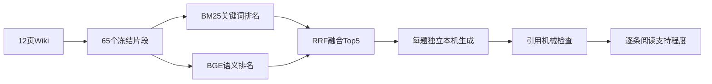

# 记忆与RAG：个人Wiki实践复盘草稿

2026-11-01，Codex按本人真实运行整理的证据与AI解释草稿，本人心得尚未提供。本页当前补W2个人Wiki应用；不在本轮重新验收第三章其他实验，也不凭本页存在认定全部W2交付完成。

## 本次真正做了什么

本人提供3条原句：“帮我解释什么是Agent”“transformer是什么”“什么是脑机接口”。选定12页Wiki，固定65块和相同查询，实测BM25、BGE语义、英文大小写规范化对照、RRF融合和3次本机生成。所有原始输出及失败保留在本地忽略目录，具体入口和范围见[个人Wiki实验](../第三章/个人Wiki混合RAG/README.md)。

检索是先找可用资料，生成是再据资料组织回答。本次的“混合”发生在关键词与语义两路排名融合；融合本身不调用生成模型，也不能补充知识。

## 已观察到的结果

- 原样英文大小写使Agent/Transformer变成UNK，规范化后Q1/Q2首条更贴题；原偏题批次保留。
- 融合后Q1仍检索到Agent入门说明，生成模型却完全拒答，显示有可用资料也可能没有被利用。
- Q2主要事实有依据，但一条真实摘引与对应论断无关，并应限定原始架构范围。
- Q3只有应用实例，拒绝补写一般定义符合提供证据的边界；不推断整个Wiki都缺资料。

详细逐题审阅见[应用复盘](../第三章/个人Wiki混合RAG/06_三题回答审阅与应用复盘.md)。本次报告3次生成、输入4704/输出527 tokens；没有共同相关性金标，不报告定量Recall或MRR，也不宣称三题都成功。

## AI解释：分清失败位置

输入与分词可能丢信息，检索可能返回偏题段落，资料可能本来缺少答案，生成也可能过度拒答或给错引用。因此分别核对源文、检索列表、模型实际收到的材料、回答事实和引用含义。格式合法、向量正常、引用字符串真实，都只是其中一层证据。

## 本人反馈与待办

- 本人提供的问题和实际运行已记录；本页的概括与解释由Codex整理，不当作本人原话。
- 本人对RAG、合理拒答与过度拒答的独立解释：尚未记录。
- 完整65块相关性金标与三路定量评估：未完成。
- 本人独立编写/修改RAG关键逻辑的证据：尚未验收。
- 当前可记：最小选定语料链路已实测，效果部分可接受；不记为全Wiki问答能力或W2全部交付通过。

保留上述缺口，按排期继续第七章成本与评估，不用反复追加同题生成请求把失败改成成功。
